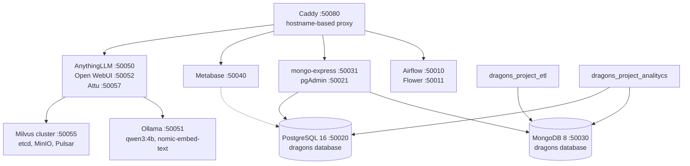

# 🐉 DRAGONS Project NLP

### Infrastructure Platform of the DRAGONS Project

- **Project:** DRAGONS – WP1 / Task 1.1 (Pontificia Universidad Javeriana)
- **Related repositories:** [`dragons_project_etl`](https://claude.ai/dragons_project_etl) (writes data to this platform) and [`dragons_project_analitycs`](https://claude.ai/dragons_project_analitycs) (reads data from and writes results to this platform)

Core Docker-based infrastructure for **orchestration, persistence, analytics, and RAG**. It serves as the integration point for the other repositories: the ETL stores its collections in the MongoDB instance hosted here, while the analytics component publishes its results to MongoDB and PostgreSQL.

> **Current actual scope.** MongoDB, PostgreSQL, Metabase, Airflow, the RAG stack, and Caddy can be started using `docker compose`. There are no data DAGs yet (only `dragons_smoke`), no ingestion code or RAG API implementation (`services/` is empty), and no version-controlled Metabase dashboards.



## Services

| Component | Services | Main Image |
|---|---|---|
| `network` | Shared network `dragons-services-docker-network` (10.188.0.0/24) | `alpine:3.20` |
| `postgres` | PostgreSQL and pgAdmin | `postgres:16`, `dpage/pgadmin4` |
| `mongo` | MongoDB and mongo-express | `mongo:8`, `mongo-express` |
| `metabase` | Metabase with its own PostgreSQL database for metadata | `metabase/metabase`, `postgres:16` |
| `rag` | AnythingLLM, Open WebUI, Ollama (with `ollama-init`), Milvus cluster, etcd, MinIO, Pulsar, Attu | `mintplexlabs/anythingllm`, `ghcr.io/open-webui/open-webui`, `ollama/ollama:0.24.0`, `milvusdb/milvus:v2.2.6` |
| `airflow` | Webserver, scheduler, Celery worker, triggerer, Flower, Redis, and PostgreSQL metadata database | `apache/airflow:2.10.5`, `redis:7-alpine` |
| `caddy` | Local hostname-based proxy | `caddy:2` |

## Ports

All published ports use the `50000+` range.

| Service | Local URL |
|---|---|
| Caddy | [http://localhost:50080](http://localhost:50080) |
| Airflow | [http://localhost:50010](http://localhost:50010) or [http://airflow.dragons.local:50080](http://airflow.dragons.local:50080) |
| Flower | [http://localhost:50011](http://localhost:50011) or [http://flower.dragons.local:50080](http://flower.dragons.local:50080) |
| PostgreSQL | `localhost:50020` |
| pgAdmin | [http://localhost:50021](http://localhost:50021) or [http://pgadmin.dragons.local:50080](http://pgadmin.dragons.local:50080) |
| MongoDB | `localhost:50030` |
| mongo-express | [http://localhost:50031](http://localhost:50031) or [http://mongo.dragons.local:50080](http://mongo.dragons.local:50080) |
| Metabase | [http://localhost:50040](http://localhost:50040) or [http://metabase.dragons.local:50080](http://metabase.dragons.local:50080) |
| AnythingLLM | [http://localhost:50050](http://localhost:50050) or [http://rag.dragons.local:50080](http://rag.dragons.local:50080) |
| Ollama | [http://localhost:50051](http://localhost:50051) |
| Open WebUI | [http://localhost:50052](http://localhost:50052) or [http://webui.dragons.local:50080](http://webui.dragons.local:50080) |
| MinIO Console / API | [http://localhost:50053](http://localhost:50053) / [http://localhost:50054](http://localhost:50054) |
| Milvus proxy | `localhost:50055` |
| Attu | [http://localhost:50057](http://localhost:50057) or [http://attu.dragons.local:50080](http://attu.dragons.local:50080) |

To use Caddy's local domains, add the following entries to your machine's `hosts` file:

```text
127.0.0.1 dragons.local airflow.dragons.local flower.dragons.local pgadmin.dragons.local
127.0.0.1 mongo.dragons.local metabase.dragons.local rag.dragons.local webui.dragons.local
127.0.0.1 attu.dragons.local minio.dragons.local
```

Internal service names within the Docker network:

- `dragons-mongo:27017`
- `dragons-postgres:5432`
- `dragons-rag-milvus-proxy:19530`
- `dragons-rag-ollama:11434`

## Requirements

- Docker Engine with Compose v2 (on Windows: Docker Desktop or WSL2).
- Sufficient resources for the RAG stack: Milvus in cluster mode, Pulsar, and Ollama consume considerable memory.
- Internet access on the first startup to download container images and Ollama models.

## Quick Start

1. Copy each `docker/<component>/.env.example` file to `.env` and **set your own passwords** (`.env` files must not be committed to version control).

2. Create the network and start the components in the following order:

   ```bash
   cd docker/network  && docker compose up -d
   cd ../postgres     && docker compose up -d
   cd ../mongo        && docker compose up -d
   cd ../metabase     && docker compose up -d
   cd ../rag          && docker compose up -d
   cd ../airflow      && docker compose up -d
   cd ../caddy        && docker compose up -d
   ```

   Alternatively, use the scripts:

   `cd docker && ./run_all_services.sh`

   Windows: `.\run_all_services.ps1`

On the first startup, MongoDB executes `docker/mongo/init/01-init.js` to create the `documents`, `chunks`, and `pipeline_runs` collections. The `ollama-init` service downloads `qwen3:4b` and `nomic-embed-text`.

## Environment Variables

| Component | Variables |
|---|---|
| `network` | `DRAGONS_DOCKER_NETWORK_SUBNET`, `DRAGONS_DOCKER_NETWORK_GATEWAY` |
| `postgres` | `POSTGRES_USER`, `POSTGRES_PASSWORD`, `POSTGRES_DB`, `PGADMIN_DEFAULT_EMAIL`, `PGADMIN_DEFAULT_PASSWORD` |
| `mongo` | `MONGO_INITDB_ROOT_USERNAME`, `MONGO_INITDB_ROOT_PASSWORD`, `ME_CONFIG_BASICAUTH_USERNAME`, `ME_CONFIG_BASICAUTH_PASSWORD` |
| `metabase` | `MB_DB_USER`, `MB_DB_PASS`, `MB_DB_DBNAME` |
| `rag` | `ANYTHINGLLM_JWT_SECRET`, `OPENWEBUI_SECRET_KEY`, `OLLAMA_MODEL_PREF`, `EMBEDDING_MODEL_PREF`, `MINIO_ROOT_USER`, `MINIO_ROOT_PASSWORD` |
| `airflow` | `AIRFLOW_UID`, `AIRFLOW_GID`, `AIRFLOW_ADMIN_*`, `_PIP_ADDITIONAL_REQUIREMENTS` |

## How the Other Repositories Connect

| Client | Service | Connection from the Host |
|---|---|---|
| `dragons_project_etl` | MongoDB | `mongodb://<username>:<password>@localhost:50030/?authSource=admin`, database `dragons` |
| `dragons_project_analitycs` | MongoDB and PostgreSQL | `localhost:50030` and `localhost:50020`, database `dragons` |
| Metabase | PostgreSQL | Configure the data source through the Metabase interface (host `dragons-postgres`, port `5432`) |

Ports are published using mappings such as `50030:27017`, meaning they are exposed on **all network interfaces of the host machine**, not just `localhost`. If the machine is connected to a shared network, restrict the binding (for example, `127.0.0.1:50030:27017`) or configure a firewall.

## Directory Structure

```text
docker/      One Compose configuration per component, startup scripts, Airflow DAGs, and Caddyfile
data/        raw, interim, processed, and external (placeholder directories)
docs/        INFRASTRUCTURE.md
services/    ingestion, rag-api, and common (empty: API and worker code yet to be developed)
notebooks/   Exploration (empty)
prompts/     Prompts and templates (empty)
scripts/     Operational utilities (empty)
```

## Known Limitations and Recommendations

- **Airflow:** Only the `dragons_smoke` DAG exists; no DAG currently runs the ETL or analytics pipelines.
- **RAG:** AnythingLLM uses Milvus as its vector database and Ollama as its model provider, but there is no process to load documents from the ETL.
- **Metabase:** No data sources or dashboards are provisioned through code.
- **Versions:** Several images use `latest` or `main` (Metabase, mongo-express, pgAdmin, AnythingLLM, and Open WebUI), which affects reproducibility and may change licensing terms or behavior. Pin these images to specific versions.
- **Milvus:** The local cluster uses version v2.2.6. Kubernetes/Helm and a current version are recommended for production.
- **Security:** Example values are intended for development, and ports are published on all network interfaces. Change passwords and secrets, and restrict bindings to `127.0.0.1` before sharing or deploying the environment.

## License

The code and configuration in this repository are distributed under the **Apache License 2.0** (see [`LICENSE`](https://claude.ai/chat/LICENSE) and [`NOTICE`](https://claude.ai/chat/NOTICE)).

This repository **does not distribute** third-party software. Instead, the software is downloaded as container images when the environment is started, and each image is subject to its own license. A summary and relevant notices for MongoDB, Metabase, MinIO, and Open WebUI—which are not licensed under Apache/MIT—are available in [`THIRD_PARTY_LICENSES.md`](https://claude.ai/chat/THIRD_PARTY_LICENSES.md).

## Funding

This work has received funding from the European Union's Horizon Europe Research and Innovation Programme under Grant Agreement No. 101291624. The views and opinions expressed are those of the authors and do not necessarily reflect those of the European Union or the granting authority.

## Contact

**PhD Luis Gabriel Moreno Sandoval** — Pontificia Universidad Javeriana — 📧 [morenoluis@javeriana.edu.co](mailto:morenoluis@javeriana.edu.co)
